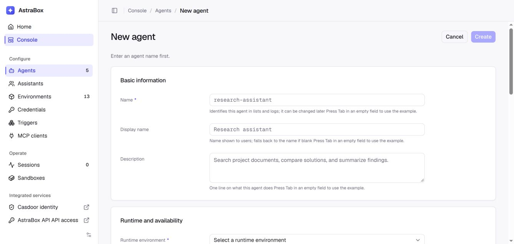

# Agent Skills

> Attach domain expertise to your Agent.

Skills add **domain expertise** to an Agent. A Skill is a structured set of
instructions and procedures that makes an Agent more capable and reliable on a
specific kind of task.

Open **Console → Agents**, create or open an Agent, and select Skills in the
**MCP, Skills and Plugins** section.



## Ways to add Skills

| Method | Where | Description |
| --- | --- | --- |
| Catalog Skill | **Skill configuration** on the Agent detail page, when the deployment runs an [extension catalog](adding-tools.md#extension-catalog) | Select a reusable Skill from the deployment's catalog |
| Direct Git source | **MCP, Skills and Plugins** on the Agent create or edit page | Add a repository URL with an optional revision and subdirectory |
| Structured source | The same Skills field | Configure SSH Git with an approved deploy key, or content from a deployment-installed provider |

The direct Skills field is a JSON array of Git strings or source objects. See
[Skill content providers](providers/skill-content.md) for the object format,
SSH credentials and installing a non-Git provider.

## Versioning model

Git Skills use a repository and an optional revision:

- **Skill source** — a repository URL with an optional `@ref` and `#path`, for
  example `https://github.com/example/skills.git@main#skills/code-review`.
- **Pinned revision** — use a reviewed commit SHA when the Skill must not
  change until the Agent is edited.
- **Unpinned revision** — omitting the ref follows the repository's default
  branch; a branch or tag follows that named ref when a runtime is prepared.
- **Catalog Skill** — the catalog supplies the source behind an entry; the
  Agent stores the selection.

A structured source names its provider and version explicitly. The provider
resolves that version to immutable content before AstraBox checks its cache;
access is checked on every preparation, including cache hits.

AstraBox does not create a second Skill-content format. It prepares the Skill
in the native Skill directory used by the selected Agent program.

For a private HTTPS source, a platform administrator must configure an
**HTTP Basic (Git HTTPS)** credential and assign its Vault to the Agent before
the Skill is downloaded. Use only the repository URL as the credential
destination; keep `@ref` and `#path` in the Skill source. This applies to both
direct sources and catalog Skills. See the
[configuration steps](credentials.md#private-git-repositories). A Skill source
whose HTTP(S) URL carries a username or token is refused: the source is stored
with the Agent and repeated in download errors, while the Vault credential is
added outside the sandbox and never stored with the Agent.

## What Skills Do

- **Inject domain knowledge** — give a generalist Agent specialized abilities (code review, document generation, etc.).
- **Standardize procedures** — ensure the Agent follows consistent steps and produces consistent output.
- **Reusable** — define once and share across multiple Agents.

## Skill File Layout

A Skill repository contains a directory whose core file is `SKILL.md`:

```
my-skill/
├── SKILL.md          # Required: Skill definition
├── templates/        # Optional: template files
│   └── report.md
└── examples/         # Optional: example files
    └── sample.json
```

`SKILL.md` is the core file, written as YAML frontmatter plus Markdown:

```markdown
---
name: my-skill
description: Perform structured code reviews and produce improvement suggestions
---

# Code Review

## Steps
1. Analyze the structure and architecture of the code.
2. Check for common issues (security, performance, maintainability).
3. Output a structured review report.

## Pitfalls
- Don't fixate on formatting — prioritize logic errors.
- Provide concrete fixes rather than vague critiques.
```

## Create a Skill

Create the Skill directory in a Git repository and commit its complete content.
Record the repository URL, revision, and subdirectory. A deployment-installed
content provider can also supply a versioned Skill directory from another
source. AstraBox has no separate Skill zip-upload endpoint.

When the catalog's provider has a management page, **Manage Skills in** the
catalog on the Agent detail page opens it; use it to add a Skill to
the catalog.

## Bind to an Agent

Open the Agent in the web console. To use a catalog Skill, select it under
**Skill configuration** and save. To use a direct source, add its Git string
or source object to the JSON array in the Skills field under
**MCP, Skills and Plugins** and save that section. Direct sources do not
require an extension catalog.

## Versioning

For a Git Skill, commit the changes and update the Agent's Git ref or the
catalog entry when that revision should be used. For another source provider,
publish through that supplier and update the source object's version.
An already-running Agent program is not rewritten in place; when AstraBox first
prepares or rebuilds a Session runtime, it resolves the Agent's current Skill
sources.

With prewarming enabled, Skills may already be prepared before a Session starts.
Use **Reprepare** on the Agent to fetch its saved Skill sources again and replace
unclaimed capacity. Existing Sessions are not interrupted, and pinned commits
remain pinned.

## Get a Skill

Open the Agent detail page. Direct sources appear in the Skills field
under **MCP, Skills and Plugins**, and the selected catalog Skills in the
catalog picker beside it.

## List Skills

Open the Agent detail page. The catalog picker under **Skill configuration**
lists the catalog's Skills available to that Agent. Its **Manage Skills in**
button opens the catalog's management page when the provider has one.

## Authoring Tips

1. **State the trigger** — write the `description` so it's clear when this Skill should be used.
2. **Be concrete in steps** — describe precise actions, not vague guidance.
3. **Document pitfalls** — help the Agent avoid common mistakes.
4. **Provide validation** — tell the Agent how to confirm the task is complete.

## FAQ

**Q: How are Skills different from the Agent `system` prompt?**

A: `system` is general guidance that applies to every task. A Skill is an
on-demand expertise module the Agent activates based on the task at hand.

**Q: How many Skills can an Agent reference?**

A: There's no hard limit, but keep it under 10 to maintain predictable behavior.

**Q: Which Agent programs support Skills?**

A: Support is declared by the selected Agent program. AstraBox rejects Skill
configuration that the program does not consume.

**Q: Is there a size limit on a Skill zip?**

A: AstraBox does not upload Skills as zip archives. The source provider and
sandbox limits apply to the content loaded into the runtime.

## Next steps

- [Agent tools and extensions](adding-tools.md) — Configure MCP servers,
  Skills, and Plugins.
- [Defining an Agent](authoring-agents.md) — Review Agent configuration.
- [Sessions](sessions.md) — Start work with an Agent.
- [Quickstart](quickstart.md) — Run your first AstraBox Agent in five steps.
