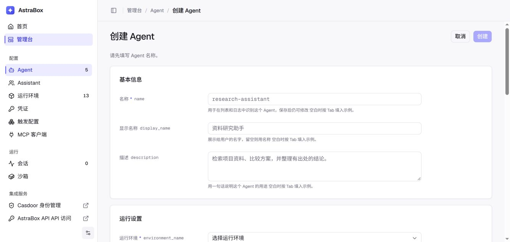

# Agent MCP、Skill 和 Plugin 配置

MCP 服务器、Skill 和 Plugin 可以扩展 Agent 的能力。在创建或更新 Agent 时配置它们，让 Agent 可以访问外部服务、使用领域流程和打包扩展。

Agent 能添加什么取决于它的 Agent 程序，由程序自己声明；程序不读取的字段会在保存 Agent 时被拒绝。Skill 适用于所有内置程序：Claude Code 从其配置目录读取，Codex、Pi 和 DeepSeek Harness 从三者共同扫描的 `~/.agents/skills` 读取。Codex 接受 Codex 插件（kind 为 `codex-plugin` 的 `packages`）：带 Codex、Claude Code 或 Cursor `plugin.json`，或 Agent Plugins v1.0 `plugin.json` 的插件目录，AstraBox 在 Codex 启动前于对话的 home 中写入一个插件市场，由 Codex 自己安装。作者声明的 MCP 服务器适用于所有程序，各自写入程序自己的配置：Claude Code 和 Hermes 接受 stdio、HTTP 和 SSE 服务器；Codex、Pi 和 DeepSeek Harness 接受 stdio 和 streamable HTTP 服务器。Claude Code 插件（kind 为 `claude-plugin` 的 `packages`）适用于 Claude Code。Pi 从其设置（`engine_options.settings`）的 `packages` 列表安装自己的包，Pi 在启动时拉取它们。DeepSeek Harness 接受插件 Bundle，即其 web profile `package.json` 的 `dependencies`（`engine_options.profile_package`），AstraBox 在 harness 启动前写入并用 `dsh plugin --profile web install` 安装；profile 组装（patch 层）也以 Bundle 的形式打包。受限 Environment 会像放行 Skill 的 Git 来源一样放行这些来源所指的主机（它们的 git 主机和 npm registry）：公网主机会为该 Agent 自动加入，私网主机只有 Environment 列出时才放行。连接器适用于所有程序。原生工具始终可用。

## 扩展的作用

读写文件、编辑代码、执行命令和搜索等原生工具由所选 Agent 程序提供。AstraBox 不使用单独的 `tools` 字段复制一套工具定义。

Agent 配置可以增加三类扩展：

- **MCP 服务器**提供实时函数和数据。
- **Skill**提供可复用的提示词、流程和配套文件。
- **Plugin**把 Skill、命令和 MCP 定义打包在一起。

AstraBox 首次准备或重建 Session 运行实例时，会在沙箱中准备这些扩展。Agent 程序根据任务决定何时使用。

预热可以在 Session 启动前准备好扩展。要按已保存的配置重新拉取 Plugin 和 Skill，
请在 Agent 上使用「重新预热」。它只替换待领取资源，现有 Session 保留其运行实例；
固定的 Commit 版本不会自动升级。

## 可用扩展

MCP 服务有两种连接类型：运行在沙箱外的远程 HTTP 服务，或运行在沙箱内的本地 stdio
命令。连接类型与配置来源是两个独立维度。管理员集中配置的远程 MCP 服务仍然是远程
MCP 服务；集中管理只会改变由谁维护它的定义。

| 扩展 | 用途 | 典型场景 |
| --- | --- | --- |
| 远程 MCP 服务器 | 调用运行在 Session 沙箱之外的 MCP 服务 | 数据库、工单系统、文档服务、内部 API |
| 本地 stdio MCP 服务器 | 在 Session 沙箱中启动 MCP 命令 | 文件系统工具、本地分析器、命令行集成 |
| Skill | 提供专门流程和配套文件 | 代码审查、发布检查、报告生成 |
| Plugin | 安装经过审核的 Skill、命令和 MCP 定义组合 | 团队扩展包和领域工作流 |

注意事项：

- 只要服务器运行在沙箱之外，它就是**远程 MCP 服务器**，无论配置保存在 Agent、由管理员统一管理，还是来自 Plugin。这些方式只改变谁维护配置。
- 所选 Agent 程序决定支持哪些扩展格式。如果它不能使用某项配置，AstraBox 会拒绝保存这个 Agent。
- 保存 Agent 不会重新配置正在执行的任务。AstraBox 在首次准备或重建 Session 运行实例时使用最新的扩展配置。
- 网络规则和凭证与 MCP 定义是两项独立配置。沙箱必须能够访问远程服务器，受保护凭证也必须匹配准确的目标地址。

## Agent 自身扩展可以访问的范围 {#what-extensions-may-reach}

任何已登录用户都可以创建 Agent，因此 Agent 自己声明的扩展只能访问管理员提供的范围：

- 在 `limited` Environment 中，Agent 的 Skill 和 Plugin 所在的 Git 主机会加入放行
  主机；Environment 允许远程 MCP 服务时，Agent 的远程 MCP 服务也会加入。只有公网
  地址，或 Environment 已列出的主机，才会被加入。
- 私有、回环或链路本地地址属于部署自己的网络：平台和其他沙箱所在的 Docker 网桥，
  以及云厂商的元数据服务。使用这类地址的主机，或解析到这类地址、无法解析的名称，
  会在保存 Agent 时以 `AGENT_EGRESS_HOST_REFUSED`（403）拒绝，准备沙箱前还会再检查
  一次。要开放内网主机，请由管理员把主机、IP 或 CIDR 加入 Environment 的放行主机。
- 主机名在保存 Agent 时解析。沙箱每次连接时会重新解析，因此这项检查说明的是该名称
  在保存那一刻指向的地址。
- `unrestricted` Environment 本来就允许所有目标，Agent 的主机不会改变它。
- Agent 自己的 MCP 定义不能设置 `provider` 或 `credential_target_url`，只有管理员的
  MCP 目录分配可以设置。参见[使用 Vault 认证](credentials.md)。
- 管理员在 MCP 和 Skill 目录中发布的扩展保留管理员配置的主机。

## 原生能力与浏览器能力

浏览器和 Web 能力属于所选 Agent 程序，或属于它支持的扩展。AstraBox 没有一套带有独立工具名的平台级浏览器工具集。

Agent 程序本身支持浏览器时，使用它的原生配置；否则添加浏览器 MCP 服务器或经过审核的 Plugin，并在 Environment 网络策略中允许所需的远程地址和包下载地址。

接入浏览器能力时：

- 使用 Agent 程序或 MCP 服务器定义的名称和权限规则；
- 修改 Agent 不会改变正在运行的任务；AstraBox 下次准备或重建 Session 运行实例时使用最新设置；
- 验证一次真实浏览器操作，以及扩展提供的实时预览入口；
- 不要假设其他 Agent 程序具有相同的浏览器能力。

## 当前格式

Agent 级扩展使用所选 Agent 程序支持的原生格式。打开「管理台 > Agent」，创建或打开一个 Agent，然后使用「MCP、Skill 与 Plugin」部分。项目代码仓库单独配置在「工作区配置」中。

MCP 服务定义保存服务名称、URL、transport 和允许发送的请求头。密钥值保存在 AstraBox
Credential Vault 中，并把该 Vault 分配给 Agent。运行时由沙箱直接连接 MCP 服务；所选
provider 只在符合规则的受保护出站请求上加入凭证，让密钥留在沙箱之外。



部署启用[扩展目录](#extension-catalog)时，已有 Agent 的「MCP 配置」和「Skill 配置」分别把目录多选框（以目录命名，例如「来自 LiteLLM 的 MCP 服务」）和自定义配置字段放在一起；两类来源合并生效，MCP 服务名称不能重复，完全相同的 Skill 来源会去重。不启用目录时，这两个字段单独显示为「MCP 服务」和「Skill」。直接配置字段使用下面的格式：

```json
{
  "mcp_servers": {
    "public-data": {
      "type": "http",
      "url": "https://mcp.example.com/mcp"
    }
  },
  "skills": [
    "https://github.com/example/agent-skills.git@REVIEWED_COMMIT_SHA#skills/code-review"
  ],
  "packages": [
    {
      "kind": "claude-plugin",
      "url": "https://github.com/example/agent-plugins.git",
      "sha": "REVIEWED_COMMIT_SHA",
      "paths": ["plugins/code-review"]
    }
  ]
}
```

系统提示词和所有扩展都可以不配置。只选择这个 Agent 需要的能力，然后点击「创建」或「保存」。

### 仓库需要鉴权时 {#repository-authentication}

如果 Plugin 或 Skill 仓库需要 HTTPS 鉴权，请**平台管理员**打开**管理台 → 凭证**，
添加 **HTTP Basic（Git HTTPS）** 凭证，填写仓库的完整 HTTPS 地址、用户名和访问
Token，再将所在 Vault 分配给需要下载扩展的 Agent。

Plugin 或 Skill 配置中的仓库 URL 保持不含 Token，完成分配后新建 Session。
完整的管理台操作步骤、Gitee 示例和拉取报错排查见
[私有 Git 仓库鉴权](credentials.md#private-git-repositories)。

这项凭证用于下载扩展。如果 Plugin 内的 MCP 服务也需要认证，还需配置对应的服务
凭证，参见 [MCP 凭证配置](credentials.md#2-add-a-credential)。

## 扩展配置示例

### 最小配置（仅远程 MCP）

```json
{
  "mcp_servers": {
    "public-data": {
      "type": "http",
      "url": "https://mcp.example.com/mcp"
    }
  }
}
```

### 完整开发环境

```json
{
  "mcp_servers": {
    "workspace-files": {
      "command": "npx",
      "args": ["-y", "@modelcontextprotocol/server-filesystem", "/workspace"]
    },
    "public-data": {
      "type": "http",
      "url": "https://mcp.example.com/mcp"
    }
  },
  "skills": [
    "https://github.com/example/agent-skills.git@REVIEWED_COMMIT_SHA#skills/code-review"
  ],
  "packages": [
    {
      "kind": "claude-plugin",
      "url": "https://github.com/example/agent-plugins.git",
      "sha": "REVIEWED_COMMIT_SHA",
      "paths": ["plugins/development"]
    }
  ]
}
```

## 扩展目录 {#extension-catalog}

扩展目录是部署统一维护的一组 MCP 服务和 Skill，Agent 和 Assistant 从中选择，而不必在每条记录上重复填写定义。目录来自部署用 `ASTRABOX_EXTENSION_PROVIDER` 选择的扩展 provider：

| 取值 | 目录 |
| --- | --- |
| 留空（默认）或 `litellm` | 内置 LiteLLM 网关中登记的 MCP 服务和 Skill。Agent 管理者在 Agent 页面用「在 LiteLLM 中管理 MCP 服务」和「在 LiteLLM 中管理 Skill」打开它的管理页面。 |
| `builtin` | 管理员通过 `/api/v1/admin/mcp-servers` 在 AstraBox 中登记的 MCP 服务。没有 Skill，也没有管理页面。 |
| `none` | 不启用目录。Agent 和 Assistant 只使用记录上直接填写的 MCP 服务、Skill 和扩展包。 |
| 其他名称 | 已安装的扩展包在 `astrabox.providers.extensions` 入口点注册的 provider。 |

控制台用 provider 的名称称呼目录，只有 provider 提供管理页面时才显示管理入口。取值不是任何已安装 provider 注册的名称时，启动会被拒绝。Compose 安装在 `containers/.env` 中设置这个变量。

### 不启用扩展目录

设置 `ASTRABOX_EXTENSION_PROVIDER=none` 后，Agent 页面、Assistant 页面和 Assistant 默认配置页面只显示记录自己的 MCP、Skill 和扩展包字段，不会向任何目录发送请求。目录 API（`GET /api/v1/agents/{agent_id}/extensions`，以及 Assistant 和默认配置的对应接口）返回 `409 EXTENSION_CATALOG_DISABLED`。

启用目录期间保存的目录选择仍会留在记录上。AstraBox 不会丢弃它，也不会在缺少它的情况下运行：

- 启动日志会列出仍持有目录选择的每个已启用 Agent、每个 Assistant 以及 Assistant 默认配置。
- 为这类 Agent 或 Assistant 开始工作（新对话、预热的运行实例、Assistant 工作区）会以 `EXTENSION_CATALOG_DISABLED` 失败，而不是带着比记录更少的工具启动；Assistant 默认配置持有目录选择时，所有 Assistant 都是如此。新建 Agent 对话返回 `409`。已有对话仍可查看。
- 记录页面会列出这些选择（MCP 服务的 provider 和条目、Skill 的 Git 来源），并提供「移除这些选择」。移除会保存一个空选择，这是不启用目录时唯一接受的选择。如果还要使用某个目录 Skill，先把列出的 Git 来源加到「Skill」字段，再移除选择。

## 更新 Agent

在「管理台 > Agent」中打开 Agent。在扩展卡片中修改所选 MCP 服务器或 Skill，或修改直接配置的 MCP、Skill 和 Plugin 仓库字段，然后点击该部分的「保存」。

:::note
保存不会重新配置正在执行的任务。AstraBox 在首次准备或重建 Session 运行实例时使用最新保存的 Agent。如果其他用户先保存了同一个 Agent，控制台会提示冲突，不会覆盖对方的修改。
:::

## 查看当前扩展配置

在「管理台 > Agent」中打开 Agent。「MCP、Skill 与 Plugin」部分显示直接配置的 MCP 定义、Skill 来源和 Plugin 仓库；部署启用扩展目录时，也显示从目录中选择的 MCP 服务和 Skill。

## 常见问题

**Q：不配置扩展会怎样？**

A：Agent 程序仍然保留自己的原生工具，只是 Agent 中没有配置额外的 MCP 服务器、Skill 或 Plugin。

**Q：能否在 Session 级别覆盖扩展配置？**

A：目前不支持。扩展配置属于 Agent。AstraBox 在首次准备或重建 Session 运行实例时读取当前 Agent 配置。需要另一组扩展时，请使用另一个 Agent。

**Q：扩展的顺序重要吗？**

A：Agent 程序根据任务决定何时使用扩展。程序通过名称访问扩展时，名称必须唯一。

**Q：扩展格式会随时间变化吗？**

A：格式属于 Agent 程序、MCP 协议、Skill 规范或 Plugin 格式。请固定经过审核的 Git 版本，并关注相应上游项目的版本说明。
